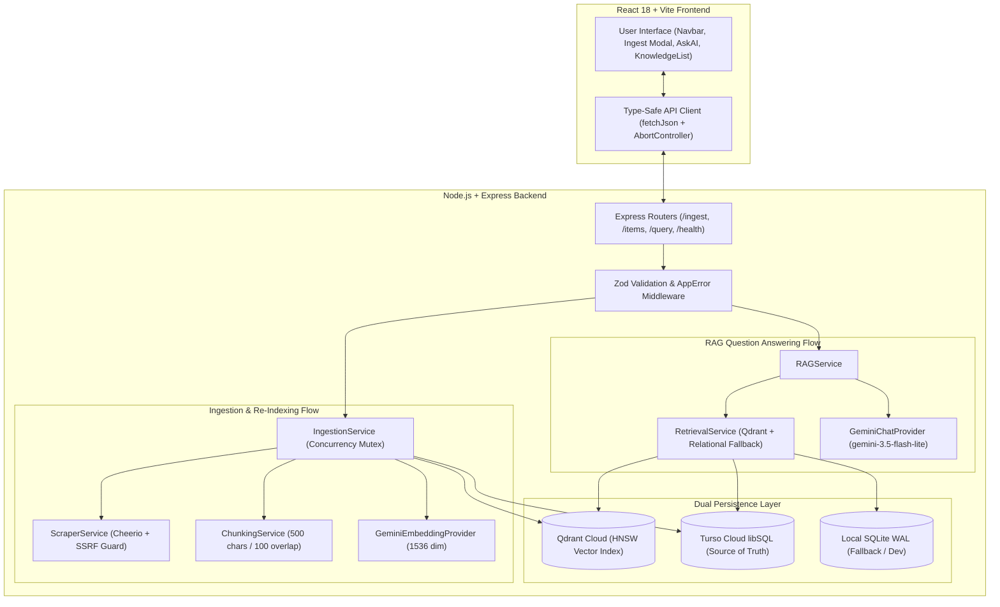

# Turium AI Knowledge Inbox

A production-grade AI Knowledge Inbox built as part of the Full Stack Developer recruitment assignment for **Turium Enterprise AI**.

Turium AI Knowledge Inbox is a full-stack application designed to save notes and web URLs, automatically chunk and embed their content, persist them across **Turso Cloud (hosted libSQL)** and **Qdrant Cloud (vector search)** with **Google Gemini**, and answer natural-language questions grounded strictly in saved knowledge with verified source chunk citations.

---

## Table of Contents

1. [Project Overview](#project-overview)
2. [Key Features](#key-features)
3. [Technology Stack](#technology-stack)
4. [System Architecture](#system-architecture)
5. [Project Structure](#project-structure)
6. [Prerequisites](#prerequisites)
7. [Environment Configuration](#environment-configuration)
8. [Installation and Local Development](#installation-and-local-development)
9. [API Documentation](#api-documentation)
10. [RAG Architecture & Pipeline Deep Dive](#rag-architecture--pipeline-deep-dive)
11. [Data Persistence & Storage Design](#data-persistence--storage-design)
12. [Security Architecture](#security-architecture)
13. [Limitations & Production Scaling Roadmap](#limitations--production-scaling-roadmap)
14. [Automated Testing Suite](#automated-testing-suite)
15. [Production Deployment (Render)](#production-deployment-render)
16. [License](#license)

---

## Project Overview

### What the Application Does
The Turium AI Knowledge Inbox is a personal knowledge management and grounded question-answering system. It enables users to:
1. Ingest arbitrary text notes or live web content via HTTPS URLs.
2. Automatically parse and extract clean readability text, stripping scripts, styles, navigations, and advertisements.
3. Partition text into deterministic overlapping chunks and generate 1536-dimensional semantic vector embeddings via Google Gemini.
4. Persist relational items and chunks in **Turso Cloud (hosted libSQL)** as the Primary Source of Truth and index vector points in **Qdrant Cloud** with HNSW indexing.
5. Ask natural-language questions across the entire knowledge inbox or scoped to a specific item.
6. Synthesize grounded answers using Google Gemini with strict fallback and citation validation rules to mitigate unsupported claims, providing verified source chunk citations with content-based SHA-256 deduplication.
7. Safely delete items with relational cascade and synchronized vector purge.

### System Workflow
```
[User Note / Web URL] ──> [Server Fetch & Scrape (SSRF Guarded)] ──> [Text Chunking] ──> [Gemini Embeddings]
                                                                                                │
                                                    ┌───────────────────────────────────────────┴────────────────────────┐
                                                    ▼                                                                    ▼
                                      [Turso Cloud (libSQL)]                                                   [Qdrant Cloud]
                                   Source of Truth: Items & Chunks                                           HNSW Vector Index
                                                    ▲                                                                    │
                                                    │ Hydration                                                          │ Top-K Candidates
                                                    │                                                                    ▼
[User Question] ──> [Gemini Query Embedding] ──> [Semantic Retrieval (Scoped / Global)] <────────────────────────────────┘
                                                       │
                                                       ▼
[Top-K Grounded Chunks] ──> [Gemini Grounded Synthesis] ──> [Answer + Verified SHA-256 Citations]
```

---

## Key Features

- **Dual-Storage Persistence (Turso + Qdrant):** Relational metadata and raw content stored in Turso Cloud (libSQL), paired with dedicated high-performance vector search in Qdrant Cloud. Includes automated fallback to local SQLite WAL for local development and offline environments.
- **Item-Scoped Semantic Retrieval:** Questions can be answered across all saved knowledge or restricted to a single selected document for focused analysis.
- **Safe Duplicate URL Re-Ingestion:** Conservative URL normalization (RFC 3986) updates existing items in-place instead of creating duplicates. Implements blue-green re-indexing: generates embeddings and upserts new Qdrant points before atomically replacing Turso chunks, rolling back new vectors if the database transaction fails.
- **In-Flight Concurrency Mutex:** Simultaneous ingestion requests for the same normalized URL coalesce into a single execution, eliminating race conditions.
- **Item Deletion & Vector Cleanup (`DELETE /items/:id`):** Transactionally deletes database chunks and parent item records while safely purging associated vector points in Qdrant using chunk IDs. Prevents reporting successful deletion if vector cleanup fails.
- **Content-Based SHA-256 Citation Deduplication:** Deduplicates identical chunks resulting from re-ingestion while ensuring distinct content revisions from the same source URL remain individually cited.
- **Robust Async & Scope Protection in UI:** Switching scopes or clearing to global search instantly cancels in-flight requests via `AbortController`, bumps monotonic request generation counters, and resets previous answers, citations, and errors.
- **Multi-Layer SSRF & Network Protection:** Pre-flight DNS validation against 16 IPv4 and 9 IPv6 private/reserved ranges (including cloud metadata `169.254.169.254`, loopback, carrier-grade NAT), redirect re-validation per hop (up to 5 hops), 2 MB streamed byte limits, and 10s timeouts.
- **Strict Grounding & Insufficient Knowledge Fallback:** If retrieved similarity scores fall below threshold or knowledge is missing, the system responds with *"I could not find sufficient information in your knowledge inbox to answer this question."* with 0 citations.
- **Deep Linking & Dual-View Inspector:** Citations link directly to source items in the modal inspector, offering both "Extracted Chunks" and full "Raw Content" monospace views.
- **Active Subsystem Health Monitoring:** `/health` endpoint monitors Express, Turso Cloud / SQLite, Qdrant Cloud, and Gemini API configuration with 30-second live polling.

---

## Technology Stack

| Layer | Technology | Purpose |
| :--- | :--- | :--- |
| **Frontend Framework** | React 18 | Declarative UI with reactive state management |
| **Language** | TypeScript 5.7 | Strict type safety across client and server |
| **Build Tool** | Vite 6 | Fast HMR dev server and optimized Rollup bundler |
| **Styling** | Tailwind CSS 3.4 | Modern utility-first responsive interface |
| **Icons** | Lucide React | Clean, accessible SVG iconography |
| **Backend Framework** | Node.js + Express 4.21 | Lightweight, high-throughput REST API |
| **Primary Relational DB** | Turso Cloud (hosted libSQL) | Distributed, edge-ready SQL database (Source of Truth) |
| **Local Relational DB** | Node.js native `node:sqlite` | Embedded zero-dependency SQL database with WAL mode |
| **Vector Database** | Qdrant Cloud | HNSW vector indexing, similarity search, and payload filtering |
| **HTML Parsing** | Cheerio 1.2 | Fast server-side DOM parsing and article extraction |
| **Network Security** | `ipaddr.js` + Native `fetch` | CIDR IP classification, SSRF protection, streaming byte caps |
| **Request Validation** | Zod 3.24 | Strict runtime schema parsing and error handling |
| **AI SDK** | `@google/genai` (v3.6.1) | Official Google Gen AI SDK for embeddings and chat completions |
| **Embedding Model** | `gemini-embedding-001` (1536 dim) | Semantic vector embeddings with batched processing |
| **Generative Model** | `gemini-3.5-flash-lite` | Grounded generative Q&A with JSON schema mode |
| **Structured Logging** | Pino 9.6 + `pino-http` 10.4 | High-performance JSON logging with secret redaction |
| **Testing Engine** | Node.js Test Runner (`node:test`) + `tsx` | Native TypeScript test runner (145 automated tests) |

---

## System Architecture



---

## Project Structure

```text
turium-ai-knowledge-inbox/
├── client/                               # Frontend React 18 Application
│   ├── src/
│   │   ├── api/
│   │   │   ├── client.ts                 # API client with deleteItem, query, and abort signal
│   │   │   └── types.ts                  # Shared TypeScript interfaces
│   │   ├── components/
│   │   │   ├── AddKnowledgeModal.tsx     # Ingest plain note or URL modal
│   │   │   ├── AskAI.tsx                 # Grounded Q&A interface with scope badge & async guard
│   │   │   ├── CitationCard.tsx          # Grounded citation preview cards
│   │   │   ├── ItemDetailModal.tsx       # Dual-tab chunk inspector & deletion confirmation
│   │   │   ├── KnowledgeList.tsx         # Saved items feed, search, filters & delete dialog
│   │   │   └── Navbar.tsx                # Header navigation and live backend health pill
│   │   ├── App.tsx                       # App layout, state orchestration & scoped item sync
│   │   ├── index.css                     # Tailwind CSS entrypoint
│   │   └── main.tsx                      # Vite React root mount
│   ├── package.json
│   └── tsconfig.json
├── server/                               # Backend Express Application
│   ├── src/
│   │   ├── config/
│   │   │   └── env.ts                    # Strict environment variable loading and validation
│   │   ├── controllers/
│   │   │   ├── health.controller.ts      # Multi-subsystem health probe (Express, DB, Qdrant, AI)
│   │   │   ├── ingest.controller.ts      # POST /ingest note and URL ingestion
│   │   │   ├── item.controller.ts        # GET /items, GET /items/:id, DELETE /items/:id
│   │   │   └── query.controller.ts       # POST /query grounded question answering
│   │   ├── db/
│   │   │   ├── connection.ts             # Turso libSQL client & SQLite sync polyfill
│   │   │   ├── index.ts                  # Database exports
│   │   │   └── schema.ts                 # Table creation DDL and performance indexes
│   │   ├── middleware/
│   │   │   ├── error-handler.middleware.ts # Standardized API error responses
│   │   │   └── request-logger.middleware.ts# Pino HTTP structured request logging
│   │   ├── repositories/
│   │   │   ├── chunk.repository.ts       # Chunk CRUD, atomic replaceChunks, and hydration
│   │   │   ├── index.ts                  # Repository exports
│   │   │   └── item.repository.ts        # Item CRUD, findBySourceUrl, and deleteWithChunks
│   │   ├── routes/                       # Express router definitions
│   │   ├── schemas/                      # Zod validation schemas
│   │   │   ├── ingest.schema.ts          # Ingestion payload schemas
│   │   │   ├── item.schema.ts            # Item ID parameter schema
│   │   │   └── query.schema.ts           # Question answering request schemas
│   │   ├── services/
│   │   │   ├── chat.service.ts           # Google Gemini chat completion provider
│   │   │   ├── chunking.service.ts       # Deterministic sliding-window chunker
│   │   │   ├── embedding.service.ts      # Gemini batched vector generation
│   │   │   ├── ingestion.service.ts      # Ingestion mutex, re-indexing, and cleanup
│   │   │   ├── prompt.service.ts         # Grounded prompt construction
│   │   │   ├── qdrant.service.ts         # Qdrant client, HNSW search, and cleanup registry
│   │   │   ├── rag.service.ts            # RAG synthesis and citation validation
│   │   │   ├── retrieval.service.ts      # Qdrant retrieval + relational fallback
│   │   │   └── scraper.service.ts        # SSRF-guarded HTTP fetcher and Cheerio parser
│   │   ├── utils/                        # Pino logger and URL normalization utilities
│   │   ├── app.ts                        # Express application factory
│   │   └── index.ts                      # Server bootstrap and graceful shutdown
│   ├── tests/                            # 141 automated unit, architecture & regression tests
│   ├── package.json
│   └── tsconfig.json
├── data/                                 # Local SQLite storage directory (when Turso not used)
├── .env.example                          # Authoritative environment template
├── package.json                          # Workspace orchestration
└── README.md
```

---

## Prerequisites

- **Node.js:** `>= 22.13.0` (Active LTS: Node.js 22 LTS or Node.js 24 LTS; verified on `v24.16.0`).
- **npm:** `>= 10.x`
- **Google Gemini API Key:** Required for generating embeddings and chat completions ([Google AI Studio](https://aistudio.google.com/)).
- **Turso Cloud Database (Optional for Cloud):** Database URL and auth token from [Turso](https://turso.tech/). If omitted, local SQLite is used automatically.
- **Qdrant Cloud Cluster (Optional for Cloud):** Cluster URL and API key from [Qdrant Cloud](https://cloud.qdrant.io/). If omitted, relational cosine similarity search is used automatically.

---

## Environment Configuration

Configuration is managed via a single `.env` file at the repository root.

```ini
# Server Configuration
PORT=4000
NODE_ENV=development
CLIENT_ORIGIN=http://localhost:5173

# Database Configuration (Turso Cloud hosted libSQL)
# Leave TURSO_DATABASE_URL empty to run on local embedded SQLite
TURSO_DATABASE_URL=libsql://your-turso-database.turso.io
TURSO_AUTH_TOKEN=your_turso_auth_token_here
DATABASE_PATH=./data/knowledge_inbox.db

# Vector Database (Qdrant Cloud)
# Leave QDRANT_URL empty to use in-process relational vector retrieval fallback
QDRANT_URL=https://your-cluster-url.qdrant.tech:6333
QDRANT_API_KEY=your_qdrant_api_key_here
QDRANT_COLLECTION_NAME=knowledge_chunks

# Google Gemini AI Configuration
GEMINI_API_KEY=your_actual_gemini_api_key_here
GEMINI_CHAT_MODEL=gemini-3.5-flash-lite
GEMINI_EMBEDDING_MODEL=gemini-embedding-001
GEMINI_EMBEDDING_DIMENSIONS=1536
```

---

## Installation and Local Development

### 1. Install Dependencies
```bash
git clone <repository-url>
cd "Turium AI"
npm install
```

### 2. Configure Environment
```bash
# Windows PowerShell:
Copy-Item .env.example .env

# macOS / Linux:
cp .env.example .env
```
Open `.env` and set `GEMINI_API_KEY`. (Optionally configure Turso and Qdrant credentials).

### 3. Run Development Servers
```bash
npm run dev
```
* **Frontend:** [http://localhost:5173](http://localhost:5173)
* **Backend API:** [http://localhost:4000/api](http://localhost:4000/api)
* **Health Check:** [http://localhost:4000/health](http://localhost:4000/health)

### 4. Build for Production
```bash
npm run build
```

---

## API Documentation

All routes are mounted both at the root path and under the `/api` prefix.

### 1. Ingest Knowledge (`POST /api/ingest`)
Ingests a note or remote web URL. Re-submitting an existing URL updates the record in-place instead of creating a duplicate.

#### Ingest Note:
```http
POST /api/ingest HTTP/1.1
Content-Type: application/json

{
  "source_type": "note",
  "title": "Dual-Storage RAG Architecture",
  "content": "Turium AI persists items in Turso libSQL and indexes 1536-dim vectors in Qdrant Cloud."
}
```

#### Ingest URL:
```http
POST /api/ingest HTTP/1.1
Content-Type: application/json

{
  "source_type": "url",
  "url": "https://docs.turium.ai/overview"
}
```

#### Response (`HTTP 201 Created` / `HTTP 200 OK` on update):
```json
{
  "status": "success",
  "data": {
    "item": {
      "id": "7f8b9a1c-2345-4678-9abc-def012345678",
      "source_type": "note",
      "title": "Dual-Storage RAG Architecture",
      "source_url": null,
      "raw_content": "Turium AI persists items in Turso libSQL...",
      "status": "completed",
      "created_at": "2026-11-20T10:00:00.000Z",
      "updated_at": "2026-11-20T10:00:00.000Z"
    },
    "chunk_count": 1
  }
}
```

---

### 2. List Knowledge Items (`GET /api/items`)
Retrieves summaries of all saved items ordered by `created_at DESC` with chunk counts.

#### Response (`HTTP 200 OK`):
```json
{
  "status": "success",
  "data": {
    "items": [
      {
        "id": "7f8b9a1c-2345-4678-9abc-def012345678",
        "source_type": "note",
        "title": "Dual-Storage RAG Architecture",
        "source_url": null,
        "status": "completed",
        "created_at": "2026-11-20T10:00:00.000Z",
        "updated_at": "2026-11-20T10:00:00.000Z",
        "chunk_count": 1
      }
    ],
    "total": 1
  }
}
```

---

### 3. Get Knowledge Item by ID (`GET /api/items/:id`)
Retrieves full item details, raw text, and all extracted chunks.

#### Response (`HTTP 200 OK`):
```json
{
  "status": "success",
  "data": {
    "item": {
      "id": "7f8b9a1c-2345-4678-9abc-def012345678",
      "source_type": "note",
      "title": "Dual-Storage RAG Architecture",
      "source_url": null,
      "raw_content": "Turium AI persists items in Turso libSQL...",
      "status": "completed",
      "created_at": "2026-11-20T10:00:00.000Z",
      "updated_at": "2026-11-20T10:00:00.000Z"
    },
    "chunks": [
      {
        "id": "3e4f5a6b-7c8d-9e0f-1a2b-3c4d5e6f7a8b",
        "item_id": "7f8b9a1c-2345-4678-9abc-def012345678",
        "chunk_index": 0,
        "content": "Turium AI persists items in Turso libSQL...",
        "embedding_model": "gemini-embedding-001",
        "embedding_dimensions": 1536,
        "created_at": "2026-11-20T10:00:00.000Z"
      }
    ],
    "chunk_count": 1
  }
}
```

---

### 4. Delete Knowledge Item (`DELETE /api/items/:id`)
Atomically deletes the item and chunks in Turso libSQL and purges associated vector points in Qdrant Cloud.

#### Full Success Response (`HTTP 200 OK`):
```json
{
  "status": "success",
  "message": "Item and associated chunks and vectors deleted successfully",
  "data": {
    "id": "7f8b9a1c-2345-4678-9abc-def012345678",
    "deleted_chunks": 1,
    "database_deleted": true,
    "vector_cleanup_completed": true,
    "status": "success"
  }
}
```

#### Partial Success Response (`HTTP 207 Multi-Status`):
Returned when the item and chunks are atomically deleted from Turso, but vector purge in Qdrant encountered a transient failure. Point IDs are durably registered in `pending_vector_cleanups` and retried automatically.
```json
{
  "status": "partial_success",
  "code": "VECTOR_CLEANUP_PENDING",
  "message": "Item was removed from the database, but vector cleanup in Qdrant is pending retry.",
  "data": {
    "id": "7f8b9a1c-2345-4678-9abc-def012345678",
    "deleted_chunks": 1,
    "database_deleted": true,
    "vector_cleanup_completed": false,
    "status": "partial_success",
    "code": "VECTOR_CLEANUP_PENDING",
    "orphaned_point_ids": ["c1a2b3c4-5678-90ab-cdef-1234567890ab"]
  }
}
```

#### Error Codes:
- `400 Bad Request`: `:id` is not a valid UUID format.
- `404 Not Found`: Item with `:id` does not exist in the database.

---

### 5. Grounded Question Answering (`POST /api/query`)
Submits a question to the grounded RAG pipeline. Supports optional `item_id` to scope retrieval to a single item.

#### Request (Global Query):
```http
POST /api/query HTTP/1.1
Content-Type: application/json

{
  "question": "What is the primary source of truth in Turium AI?",
  "topK": 5
}
```

#### Request (Item-Scoped Query):
```http
POST /api/query HTTP/1.1
Content-Type: application/json

{
  "question": "Summarize the key architectural decisions.",
  "item_id": "7f8b9a1c-2345-4678-9abc-def012345678",
  "topK": 3
}
```

#### Response (`HTTP 200 OK`):
```json
{
  "status": "success",
  "data": {
    "answer": "The primary source of truth in Turium AI is Turso Cloud hosted libSQL, which stores all items, raw contents, and chunks.",
    "citations": [
      {
        "chunk_id": "3e4f5a6b-7c8d-9e0f-1a2b-3c4d5e6f7a8b",
        "item_id": "7f8b9a1c-2345-4678-9abc-def012345678",
        "title": "Dual-Storage RAG Architecture",
        "source_type": "note",
        "source_url": null,
        "chunk_index": 0,
        "similarity_score": 0.884,
        "snippet": "Turium AI persists items in Turso libSQL and indexes 1536-dim vectors in Qdrant Cloud."
      }
    ],
    "metadata": {
      "question": "What is the primary source of truth in Turium AI?",
      "model": "gemini-3.5-flash-lite",
      "embedding_model": "gemini-embedding-001",
      "chunks_retrieved": 1,
      "chunks_cited": 1,
      "processing_time_ms": 1180
    }
  }
}
```

---

### 6. Subsystem Health Check (`GET /health` or `GET /api/health`)
Probes the live status of all subsystems.

#### Response (`HTTP 200 OK`):
```json
{
  "status": "ok",
  "service": "turium-ai-knowledge-inbox-backend",
  "subsystems": {
    "database": {
      "type": "turso",
      "status": "connected"
    },
    "vectorDatabase": {
      "type": "qdrant",
      "status": "connected"
    },
    "aiProvider": {
      "type": "gemini",
      "status": "configured",
      "chatModel": "gemini-3.5-flash-lite",
      "embeddingModel": "gemini-embedding-001"
    }
  },
  "uptime": 342.15,
  "timestamp": "2026-11-20T10:00:00.000Z"
}
```

---

## RAG Architecture & Pipeline Deep Dive

### 1. Ingestion & Content Normalization
- **URL Fetching:** Performed with streaming size enforcement (2 MB) and SSRF pre-flight validation.
- **Content Extraction:** Cheerio extracts the title and readable text from the DOM, stripping `<script>`, `<style>`, `<nav>`, `<header>`, `<footer>`, `<aside>`, and elements matching ad patterns.
- **URL Normalization:** Follows RFC 3986: lowercases scheme and host only; preserves path casing (`/Docs/API` vs `/docs/api`), query keys, and parameter values.

### 2. Deterministic Chunking Strategy
- **Window Size:** ~500 characters with 100-character overlap.
- **Boundary Snapping:** Prioritizes splitting on double newlines (paragraphs), then single newlines, sentence terminators (`.`, `!`, `?`), and whitespace.
- **Unicode Safety:** Preserves multi-byte UTF-16 surrogate pairs (e.g. emojis) without splitting them across chunk boundaries.

### 3. Batched Embeddings (Google Gemini)
- Vectors are generated using Google's `gemini-embedding-001` configured to 1536 output dimensions.
- Embeddings are validated for finiteness (`isFinite`) and dimensions before storage.
- Rate-limit backoff handles Google API 429 and 503 errors gracefully.

### 4. Dual-Mode Retrieval & Hydration
- **Primary Search:** Qdrant Cloud computes approximate nearest neighbors via HNSW cosine similarity. Supports item-scoped filtering via payload filter `{ key: "item_id", match: { value: itemId } }`.
- **Turso Hydration:** Candidate chunk IDs returned by Qdrant are re-hydrated against Turso libSQL via `chunkRepo.findByIds(candidateIds)`. Any orphaned or uncommitted vector points are automatically dropped.
- **Relational Fallback:** If Qdrant is unavailable or unconfigured, retrieval automatically executes an in-process cosine similarity search over serialized vectors stored in Turso libSQL.

### 5. Grounded Generation & Citation Verification
- **System Prompt:** Instructs Gemini to answer using *only* the supplied numbered context chunks.
- **Unsupported Claim Mitigation:** If information is insufficient or similarity is low, the model emits the standardized fallback message with 0 citations.
- **Provenance Validation:** Only citations matching retrieved chunk IDs are retained. Fabricated chunk IDs are discarded.
- **Content-Based SHA-256 Deduplication:** Computes a SHA-256 fingerprint over normalized chunk content, preventing duplicate citations from re-ingested content while preserving distinct revisions from the same URL.

---

## Data Persistence & Storage Design

### Database Schema (Turso libSQL / SQLite)

```sql
CREATE TABLE IF NOT EXISTS items (
  id TEXT PRIMARY KEY,
  source_type TEXT NOT NULL CHECK(source_type IN ('note', 'url')),
  title TEXT,
  source_url TEXT,
  raw_content TEXT NOT NULL,
  status TEXT NOT NULL DEFAULT 'pending' CHECK(status IN ('pending', 'processing', 'completed', 'failed')),
  created_at TEXT NOT NULL,
  updated_at TEXT NOT NULL
);

CREATE TABLE IF NOT EXISTS chunks (
  id TEXT PRIMARY KEY,
  item_id TEXT NOT NULL,
  chunk_index INTEGER NOT NULL,
  content TEXT NOT NULL,
  embedding TEXT,
  embedding_model TEXT,
  embedding_dimensions INTEGER,
  created_at TEXT NOT NULL,
  FOREIGN KEY (item_id) REFERENCES items(id) ON DELETE CASCADE,
  UNIQUE(item_id, chunk_index)
);

CREATE INDEX IF NOT EXISTS idx_chunks_item_id ON chunks(item_id);
CREATE INDEX IF NOT EXISTS idx_items_created_at ON items(created_at DESC);
CREATE INDEX IF NOT EXISTS idx_items_status ON items(status);

CREATE TABLE IF NOT EXISTS pending_vector_cleanups (
  point_id TEXT PRIMARY KEY,
  item_id TEXT NOT NULL,
  created_at TEXT NOT NULL
);
CREATE INDEX IF NOT EXISTS idx_pending_vector_cleanups_item_id ON pending_vector_cleanups(item_id);
```

### Vector Collection (Qdrant Cloud)
- **Collection Name:** `knowledge_chunks`
- **Vector Configuration:** 1536 dimensions, Cosine distance metric, HNSW index.
- **Payload Schema:** `item_id` (string), `chunk_index` (integer), `source_type` (string), `embedding_model` (string), `created_at` (string).
- **Point IDs:** Exactly equal to the chunk UUID in Turso for 1:1 synchronization.

---

## Security Architecture

1. **Protocol Restriction:** Only `http:` and `https:` schemes are accepted.
2. **SSRF Defense:** Pre-flight DNS resolution inspects destination IP addresses against 16 IPv4 and 9 IPv6 private/reserved blocks. Link-local cloud metadata endpoints (`169.254.169.254`) and loopbacks are blocked immediately.
3. **Redirect Hop Re-Validation:** Target IPs are re-checked on every redirect hop (up to 5 hops).
4. **Streamed Payload Caps:** Web requests abort immediately if response bodies exceed 2 MB.
5. **Secret Protection:** Google Gemini, Turso, and Qdrant API keys exist only in server environment variables. Pino structured logs redact sensitive headers and omit raw prompt text.
6. **SQL Injection Prevention:** All SQL queries use parameterized arguments via `@libsql/client` or `node:sqlite`.

---

## Limitations & Production Scaling Roadmap

### Current Design Scope
- **Single-User Architecture:** Designed as a personal knowledge inbox without authentication, multi-tenant isolation, or workspace permissions.
- **Synchronous Ingestion:** Ingestion runs within the HTTP request lifecycle. Remote URLs that respond slowly will delay the API response.
- **Automated Browser Testing Scope:** The automated test runner executes backend API, database, vector search, and integration workflows using isolated fixtures. Automated browser-level UI testing (e.g. Cypress or Playwright) is not currently configured; frontend correctness is validated through strict TypeScript compilation (`tsc --noEmit`), Vite production bundling, and manual browser verification.

### Realistic Production Improvements (Without Overengineering)
1. **Background Job Queue:** Offload web scraping and batch embedding generation to a Redis-backed queue (e.g. BullMQ) with WebSocket or Server-Sent Events (SSE) progress updates.
2. **Transport-Level Socket Pinning:** Eliminate the DNS rebinding TOCTOU window by pinning sockets to verified IP addresses during HTTP connection setup.
3. **Cursor-Based Pagination:** Add cursor pagination on `GET /items` to efficiently support knowledge bases with tens of thousands of documents.
4. **NLI Claim Verification:** Add a secondary Natural Language Inference check to verify sentence-level factual entailment between citations and generated claims.

---

## Automated Testing Suite

The application maintains **145 automated unit, architecture, and regression tests** running natively via Node.js test runner (`node:test`) and `tsx`.

### Running Tests
```bash
# Run all server test suites
npm run test:server

# Run TypeScript typechecks across server and client
npm run typecheck:server
npm run typecheck:client

# Run production builds
npm run build:client
npm run build:server
```

### Test Coverage Summary: **145 Tests / 14 Suites / 0 Failures**

| Test Suite | Tests | Scope |
| :--- | :---: | :--- |
| **`full-stack-journey.test.ts`** | 1 | Complete 13-step end-to-end user journey verification across ingestion, retrieval, scoping, citation verification, updating, abstention, deletion, and durable recovery |
| **`deletion-phase3.test.ts`** | 13 | Item deletion, atomic rollback, Qdrant point cleanup, HTTP 207 Multi-Status, transient outage recovery, concurrency locking, and bounded batch processing |
| **`re-ingestion-phase2.test.ts`** | 14 | Conservative URL normalization, in-place re-indexing, concurrency mutex, rollback safety, legacy URL matching, path/query case sensitivity, and recoverable Qdrant cleanup |
| **`scope-async-guard.test.ts`** | 4 | Ask AI scope switching, identical title scope resets, AbortController cancellation, and monotonic request identity guards |
| **`cloud-infrastructure.test.ts`** | 4 | Turso libSQL wrapper polyfill, MockQdrantService, vector upsert failure handling, and multi-subsystem `/health` probe |
| **`chunking.test.ts`** | 10 | Paragraph boundary preservation, sliding window overlap, Unicode surrogate safety, zero-loss content coverage |
| **`database.test.ts`** | 10 | Table initialization, WAL mode, foreign key cascades, unique chunk index constraints, and transaction rollbacks |
| **`embedding.test.ts`** | 9 | Gemini batch vector generation, 1536 dimension validation, non-finite value rejection, error mapping (429, 504, 502) |
| **`ingestion.test.ts`** | 10 | Ingestion orchestration, note and URL processing, title derivations, and chunk linking |
| **`migration.test.ts`** | 5 | Cloud migration script verification, schema execution, and dry-run assertions |
| **`rag.test.ts`** | 25 | RAG pipeline, Gemini JSON formatting, grounded answer verification, insufficient knowledge fallbacks, and prompt injection bounds |
| **`retrieval.test.ts`** | 18 | Qdrant and relational retrieval, threshold filtering, model isolation, and SHA-256 citation deduplication |
| **`scraper-network.test.ts`** | 8 | Redirect bounds, private IP redirect interception, MIME type validation, and 2 MB streaming byte cap enforcement |
| **`ssrf.test.ts`** | 14 | Loopback, RFC 1918, cloud metadata (`169.254.169.254`), carrier-grade NAT, and IPv6 unique local/link-local validation |

---

## Production Deployment (Render)

The project includes first-class support for deployment on [Render](https://render.com) using a 2-service architecture (Render Web Service for Backend + Render Static Site for Frontend) or 1-click Blueprint.

### 1-Click Blueprint (`render.yaml`)
1. In Render Dashboard, click **New +** -> **Blueprint**.
2. Connect this repository. Render automatically provisions the `turium-ai-backend` Web Service and `turium-ai-frontend` Static Site.
3. Supply your cloud credentials (`TURSO_*`, `QDRANT_*`, `GEMINI_*`) when prompted.

### Manual Setup
- **Backend Service:** Type: Web Service | Build: `npm install && npm run build:server` | Start: `npm start` | Health Check: `/health`.
- **Frontend Site:** Type: Static Site | Build: `npm install && npm run build:client` | Publish: `client/dist` | Rewrites: `/*` -> `/index.html` (200).

---

## License

MIT License. Developed for the Turium Enterprise AI Technical Assessment.
